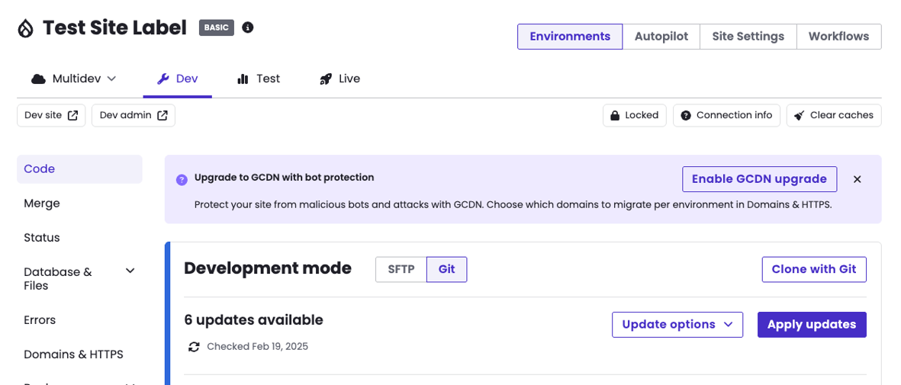

## Setup

<Alert title="Special instructions for Advanced Global CDN (AGCDN) sites" type="info">

If your site uses [Advanced Global CDN (AGCDN)](/guides/agcdn), Pantheon coordinates the upgrade with you. The upgrade button doesn't appear on the site dashboard until you've spoken with Pantheon, and you shouldn't run `terminus gcdn:upgrade` on your own. Pantheon needs to upload your AGCDN configuration before the upgrade starts, and starting it automatically moves your site's platform hostnames (`*.pantheonsite.io`) to the next-generation GCDN.

Pantheon Support will open a support ticket and email you by December 15, 2026. You can also [contact Pantheon Support](/guides/support/contact-support/) or your Account Team to get started sooner. If you've already started the upgrade on an AGCDN site, do not change your DNS records. Contact Pantheon Support for next steps.

</Alert>

<Alert title="Important" type="danger">

For the best experience, be prepared to update your DNS records as soon as possible after starting the migration. Delaying DNS migration can result in inconsistent behavior, as your site will remain on the old CDN infrastructure until DNS is pointed to the new GCDN.

</Alert>

<Alert title="Custom Domains Must Not Use CNAMEs to Platform Hostnames" type="danger">

Custom domains that use a CNAME record in their DNS settings that point to a Pantheon platform hostname (for example, `live-yoursite.pantheonsite.io`) are not supported by the next-generation GCDN and will not be supported going forward. Sites configured this way will experience interruptions when migrated.

Before activating the next-generation GCDN, check your custom domain's DNS configuration. It must resolve via A/AAAA records as shown on the site's **Domains** page, not via a CNAME pointed at a `*.pantheonsite.io` hostname. If the **Domains** page shows `Remove this detected record` next to a CNAME, remove it from your DNS provider. See [Custom Domains](/guides/domains/custom-domains) for details.

If your custom domain currently points at a platform hostname via CNAME, contact Pantheon Support before requesting migration.

</Alert>

<TabList>

<Tab title="Pantheon Dashboard" id="dashboard-setup" active={true}>

### Activation

Eligible sites will see a next-generation GCDN banner on the site dashboard in Pantheon.

1. Look for the banner on your site dashboard in Pantheon.
1. Click the banner and follow the guided activation steps.
1. Update your DNS records to point to the new GCDN infrastructure (instructions will be provided in the dashboard).



### Platform Hostnames

After you click upgrade, your platform hostnames (`*.pantheonsite.io`) are automatically migrated to the new GCDN infrastructure. You do not need to take any action for these domains. It is normal to see a few minutes of downtime on platform hostnames while the migration completes.

### Domains and DNS
<Alert title="Domain Verification and Certificate Issuance" type="danger">

**A DNS TXT record is required once to verify domain ownership.** You can remove it once your domain is active.

The certificate needs its own DNS record, which lets it be issued before you point DNS to Pantheon, avoiding downtime during cutover. We recommend the [GCDN Terminus plugin](https://github.com/pantheon-systems/terminus-gcdn-plugin) over the dashboard for this (see the **Terminus CLI** tab). It gives you the DCV delegation CNAME (`_acme-challenge.<domain>`) for the certificate, and shows more detail than the dashboard: it checks your DNS for each record and says what to do next. Add the CNAME once and keep it in place.

The dashboard currently shows a TXT record for the certificate instead. Its value can change with each verification attempt, so check the current value before you add or update the record. At renewal, Cloudflare attempts to fall back to HTTP validation, but we recommend keeping the DCV delegation CNAME in place so renewals don't depend on that fallback.

HTTP-01 validation is also available through the Terminus plugin. The certificate is issued over HTTP after you point DNS to Pantheon, so it can't be issued in advance and there may be a brief window of downtime during cutover.

</Alert>

After activating the next-generation GCDN through the dashboard, you will need to update your DNS records to point to the new infrastructure.

1. The dashboard will provide a TXT record for domain ownership verification, plus a TXT record for certificate validation. Add both to your DNS provider. **The dashboard flow uses DNS TXT record validation for both steps**, which lets your certificate be issued before you update DNS. We recommend the Terminus plugin over the dashboard: it shows more detail, checks your DNS for each record, says what to do next, and offers the DCV delegation CNAME or HTTP-01 for the certificate (the domain-ownership TXT record is still required either way) — see the **Terminus CLI** tab.

1. Once domain verification completes and your SSL/TLS certificate has been issued, the dashboard will display the recommended DNS settings (CNAME targets).

1. Update your DNS records with the provided CNAME values at your DNS provider.

- You will receive new CNAME targets pointing to Pantheon's new GCDN infrastructure.
- Set your TTL as low as possible before making changes to minimize propagation delay.
- TLS certificates are automatically provisioned once domain verification completes.

<Alert title="Note" type="info">

DNS changes may take time to propagate depending on your current TTL settings. During propagation, traffic may alternate between the old and new CDN. This is normal and resolves once propagation completes.

</Alert>

### Re-running Domain Verification

If you've added the TXT records and a domain is still pending verification, you can manually trigger a recheck from the dashboard. Open the domain on the **Domains** page; once verification has been attempted, a troubleshooting message appears with a **Force Recheck** action.

The platform retries DNS validation automatically on a backoff schedule:

- For the first few minutes, checks run seconds apart.
- For about the next two hours, they run a few minutes apart.
- After that, they run up to an hour apart.

**Force Recheck** resets that schedule and triggers an immediate validation attempt. It's useful when you added your TXT records and propagation took a while, or you stepped away during the process and the platform is now in the slower part of the backoff — instead of waiting up to an hour for the next scheduled attempt, you can kick off a new check right away. In Terminus, `terminus gcdn:verify` also asks Cloudflare to recheck the domain right away, within the limits described below in step 4.

Before you click:

- Confirm your TXT records have propagated using a DNS lookup tool (for example, `dig TXT _acme-challenge.example.com`).
- ACME TXT challenges are valid for 7–14 days depending on the certificate authority. If yours have expired, regenerate them from the dashboard before forcing a recheck.

</Tab>

<Tab title="Terminus CLI" id="terminus-setup">

<Alert title="Note" type="info">

Before proceeding with Terminus commands, you must first install the GCDN Terminus plugin.

</Alert>

<Alert title="Note" type="info">

For each domain, you add two DNS records before you update DNS: a TXT record that proves you own the domain, and a DCV delegation CNAME (`_acme-challenge`) that lets your certificate be issued before cutover and renewed automatically. If you'd rather not add the CNAME, HTTP-01 is available with `terminus gcdn:verify --method=http`. With HTTP-01, the certificate can't be issued in advance, so there may be brief downtime during cutover.

</Alert>

### Install or update the plugin

```bash{promptUser: user}
terminus self:plugin:install pantheon-systems/terminus-gcdn-plugin
```

<Alert title="Upgrading from plugin version 0.4.0 or earlier" type="warning">

`terminus gcdn:update` can't upgrade version 0.4.0 or earlier to the current version. Uninstall the plugin and install it again instead:

```bash{promptUser: user}
terminus self:plugin:uninstall pantheon-systems/terminus-gcdn-plugin
terminus self:plugin:install pantheon-systems/terminus-gcdn-plugin
```

Check the installed version with `terminus self:plugin:list`.

</Alert>

If the plugin is already installed at version 0.5.0 or later, update it to the latest version:

```bash{promptUser: user}
terminus gcdn:update
```

If you have existing custom domains on your site, follow all of the steps below to upgrade and migrate your DNS.

### 1. Upgrade your site to next-generation GCDN

```bash{promptUser: user}
terminus gcdn:upgrade <site>
```

This migrates the site from Fastly to Cloudflare GCDN across all environments. Your platform hostnames (`*.pantheonsite.io`) are automatically migrated as part of this step. It is normal to see a few minutes of downtime on platform hostnames while the migration completes.

### 2. Get your DNS records

```bash{promptUser: user}
terminus gcdn:dns <site>.live
```

For each domain, this shows its status and the records it needs:

- **TXT `_cf-custom-hostname.<domain>`:** proves you own the domain. You can remove it once the domain is active.
- **CNAME `_acme-challenge.<domain>`:** lets Cloudflare issue and renew the certificate (DCV delegation). If your DNS provider can proxy records, set it to DNS only (not proxied). Keep it in place permanently, even after the domain is active. It's extra assurance that renewals validate without you updating a record, and if another proxy sits in front of Pantheon, your certificate can fail to renew without it.
- **Traffic records:** the CNAME, or the A/AAAA records, that point the domain to Pantheon. Don't add these until step 5.

### 3. Add the TXT and `_acme-challenge` CNAME records

Add them at your DNS provider. Remove any existing `_acme-challenge.<domain>` TXT records first; they conflict with the CNAME. Don't remove unrelated TXT records, such as SPF, DKIM, or DMARC.

### 4. Verify each domain

Wait a few minutes for DNS propagation, then verify each domain:

```bash{promptUser: user}
terminus gcdn:verify <site>.live example.com
terminus gcdn:verify <site>.live www.example.com
```

`gcdn:verify` asks Cloudflare to check the domain again now (like **Force Recheck** in the dashboard), then shows its status. Pantheon sees the result within about 10 minutes; run the command again to see it. The command only rechecks when there's something new to check: the ownership TXT or certificate CNAME is in DNS with the value shown, or the domain points to Pantheon. It rechecks a domain at most every 5 minutes, and not at all once the domain is active. Use `--recheck` to skip both limits, or `--no-recheck` to only show the status.

The output lists three steps, each red until it's done and green after:

1. Ownership (TXT record)
1. Certificate (DCV CNAME)
1. Switch traffic to Pantheon

For steps 1 and 2, `gcdn:verify` looks up the records in DNS and says whether each is found, missing, or set to a different value. For step 2, it also flags `_acme-challenge` TXT records that conflict with the CNAME. A **Next:** line says what to do now.

The status is one of:

| Status | What to do |
|---|---|
| `ownership and certificate active` | Done. Point DNS to Pantheon (step 5) if you haven't yet. |
| `DNS records ready (confirmed by Pantheon)` | The domain is served through Cloudflare today (your own Cloudflare account or your current host), and Pantheon has confirmed you own it. Cloudflare still reports errors because it can't pre-validate a domain that's already on Cloudflare; the output explains them. Switch DNS (step 5), wait about 5 minutes, then run `gcdn:verify` again. |
| `ownership not confirmed yet`, `ownership verified, certificate pending`, or `ownership and certificate pending` | Add the records shown, then run `gcdn:verify` again. |
| `Action required` | Cloudflare reports a status that adding records can't fix, for example blocked or being deleted. Don't switch DNS. [Contact Pantheon Support](/guides/support/contact-support/). |

If a domain waits about 11 days for the DNS switch, Cloudflare pauses its checks (status `moved`), and marks the domain `deleted` if it stays paused for 7 more days. Run `gcdn:verify` to restart the checks.

`gcdn:verify` exits with `0` when every domain it reports on is active or ready, and `1` otherwise, so scripts can rely on it.

#### Use HTTP-01 instead of the CNAME

To switch certificate validation to HTTP as part of the recheck:

```bash{promptUser: user}
terminus gcdn:verify <site>.live example.com --method=http
```

The certificate is issued over HTTP once DNS points to Pantheon, so it can't be issued in advance and there may be brief downtime during cutover. HTTP-01 is likely to fail while the domain is proxied through Cloudflare, because the proxy intercepts HTTP validation. If HTTP-01 is your best option, disable proxying (set the record to DNS only) while the challenge completes.

#### If you can't add the CNAME

If your DNS can't take the `_acme-challenge` CNAME (for example, that name is already delegated to another provider), show the certificate's TXT record instead:

```bash{promptUser: user}
terminus gcdn:verify <site>.live example.com --cert-txt
```

The TXT value can change with each verification attempt, so run the command again and confirm the value before you add or update the record. If your domain is proxied through Cloudflare, disable proxying (set the record to DNS only) while you use the TXT record. At renewal, Cloudflare attempts to fall back to HTTP validation, but that fallback isn't guaranteed. If a renewal is pending, [contact Pantheon Support](/guides/support/contact-support/). The CNAME avoids all of this, so use it when you can.

### 5. Update your DNS records

Once `gcdn:verify` shows the domain active or ready, point it to Pantheon with one of the options in the table of `gcdn:verify` or `gcdn:dns` from step 3:

- **Option 1, the CNAME:** for subdomains, such as `www.example.com`.
- **Option 2, the A and AAAA records:** for the apex domain, such as `example.com`.

"In DNS now" shows what DNS returns today. If your domain is proxied by your own Cloudflare zone, follow [Migrate a Cloudflare-Proxied Domain (O2O)](/guides/nextgen-gcdn/o2o) instead.

- Set your TTL as low as possible before making changes to minimize propagation delay.
- After you switch, run `terminus gcdn:verify` again so Cloudflare and Pantheon detect the change sooner.

<Alert title="Note" type="info">

DNS changes may take time to propagate depending on your current TTL settings. During propagation, traffic may alternate between the old and new CDN. This is normal and resolves once propagation completes.

</Alert>

### Full workflow example

```bash{promptUser: user}
terminus gcdn:upgrade my-site
terminus gcdn:dns my-site.live
# Add the TXT and _acme-challenge CNAME records, wait a few minutes, then verify:
terminus gcdn:verify my-site.live example.com
terminus gcdn:verify my-site.live www.example.com
# Once active or ready, point DNS with the CNAME or A/AAAA records from the step 3 table
# Then verify again so the switch is detected sooner:
terminus gcdn:verify my-site.live example.com
```

</Tab>

</TabList>

## Using Cloudflare in Front of Pantheon (Orange-to-Orange)

If your domain is already proxied through your own Cloudflare zone (orange-clouded), the next-generation GCDN supports Cloudflare's [Orange-to-Orange (O2O)](https://developers.cloudflare.com/cloudflare-for-platforms/cloudflare-for-saas/saas-customers/how-it-works/) configuration, which keeps your Cloudflare zone in front of Pantheon's GCDN. To migrate an existing site, see [Migrate a Cloudflare-Proxied Domain (O2O)](/guides/nextgen-gcdn/o2o) for the full walkthrough. To add a domain to a new site, see [Connect a Cloudflare-Proxied Domain to a New Site (O2O)](/guides/nextgen-gcdn/o2o-new-site).

## Using a Third-Party CDN in Front of Pantheon

You can place a third-party CDN or reverse proxy in front of the next-generation GCDN, with one hard requirement: on every request it sends to Pantheon, the fronting service must present a TLS Server Name Indication (SNI) value that matches the HTTP `Host` header.

The next-generation GCDN routes and validates custom domains using the SNI value in the TLS handshake. Requests whose SNI does not match the `Host` header are rejected at the edge with a `403` response before they reach your site. This is intentional security behavior that prevents [domain fronting](https://en.wikipedia.org/wiki/Domain_fronting), and it cannot be disabled for individual domains.

When configuring your CDN, for each custom domain:

- Add the domain to your Pantheon environment and complete [domain verification](#domains-and-dns) so a certificate is provisioned.
- Set the CDN's origin address to the GCDN edge hostname shown in your dashboard DNS values (the `fe.` CNAME target).
- Set both the origin `Host` header and the outbound TLS SNI to the custom domain itself (for example, `www.example.com`), not the `fe.` edge hostname.

If your CDN cannot set the outbound SNI independently of the configured origin hostname, it cannot be used in front of the next-generation GCDN. Azure Front Door currently has this limitation (see [Known Limitations](#known-limitations)).

If the service in front of Pantheon is your own Cloudflare zone, use the [Orange-to-Orange configuration](/guides/nextgen-gcdn/o2o) instead.
