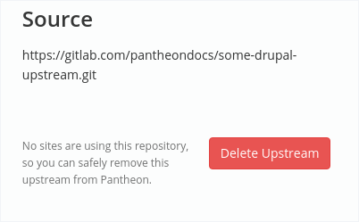

This section provides steps to delete an upstream. An upstream cannot be deleted if there are sites using it.

Follow these steps to delete your upstream.

1. [Go to the workspace](/guides/account-mgmt/workspace-sites-teams/workspaces#switch-between-workspaces) containing the upstream you want to delete.

1. Click **Settings** next to the Upstream you want to delete.

1. Select **Source** > click the **Delete Upstream** button:

  

## More resources

- [Switch an Existing Site to Upstream](/guides/upstream/switch-upstream)

- [Troubleshoot an Upstream](/guides/upstream/troubleshooting)

- [Edit an Existing Upstream](/guides/upstream/edit-upstream)