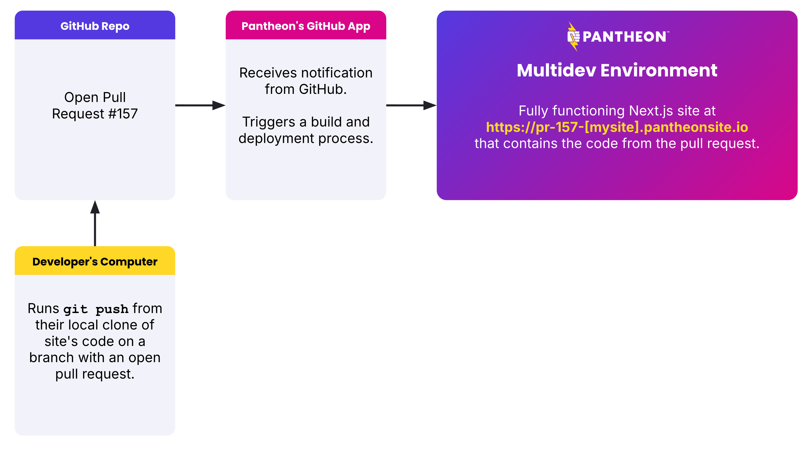

To support teams who are developing multiple features and bug fixes simultaneously, Pantheon creates environments per Git branch.

These environments are created automatically per pull request or merge request by Pantheon's external repository integration.

<!--- This image is pulled from this deck: https://docs.google.com/presentation/d/17k15auDrnpq2LdRC4P35dN5yJ4pOkPY62M7drBDkTCc/edit?slide=id.g39e43c7cf0e_0_15#slide=id.g39e43c7cf0e_0_15 --->


Additionally, if you want a longer lived environment, or one not tied to a pull request, you can prefix a branch name with `multi-` to have Pantheon create a Multidev environment for that branch.

Unlike Dev and Multidev environments for WordPress and Drupal sites on Pantheon, Multidev environments for Next.js do not have an "SFTP mode" that allows for directly changing files.
All code changes must be made through Git and deployed through Pantheon's external repository integration.

## Run tests after a deployment

Deployments to a Multidev environment are asynchronous. A GitHub Actions workflow that starts testing as soon as a commit is pushed can run against the previous code. This applies both when the environment is first created for a pull request and when later commits are pushed to it.

To avoid testing stale code, use `terminus node:builds:wait` to wait for a specific commit to finish building and deploying before the test job starts:

```bash{promptUser: user}
terminus node:builds:wait <site>.<env> --commit=<commit-sha> --max=<seconds>
```

In a pull request workflow, `<env>` is `pr-<pull-request-number>` and `<commit-sha>` is `github.event.pull_request.head.sha`. Make the test job depend on the wait step, then run your tests against the environment URL, `https://pr-<pull-request-number>-<site>.pantheonsite.io`.

For an example, see how the Pantheon Docs site waits for a deployment using a [GitHub Action](https://github.com/pantheon-systems/documentation/blob/main/.github/actions/wait-for-deployment/action.yml) and then runs [BackstopJS](https://github.com/garris/BackstopJS) visual regression tests in its [pull request workflow](https://github.com/pantheon-systems/documentation/blob/main/.github/workflows/pr-e2e.yml).
