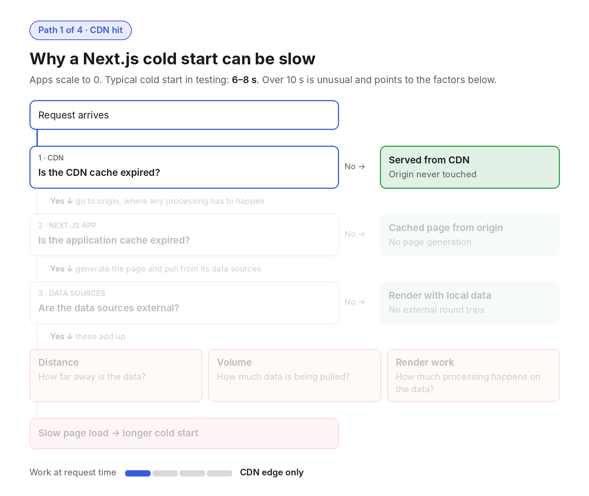
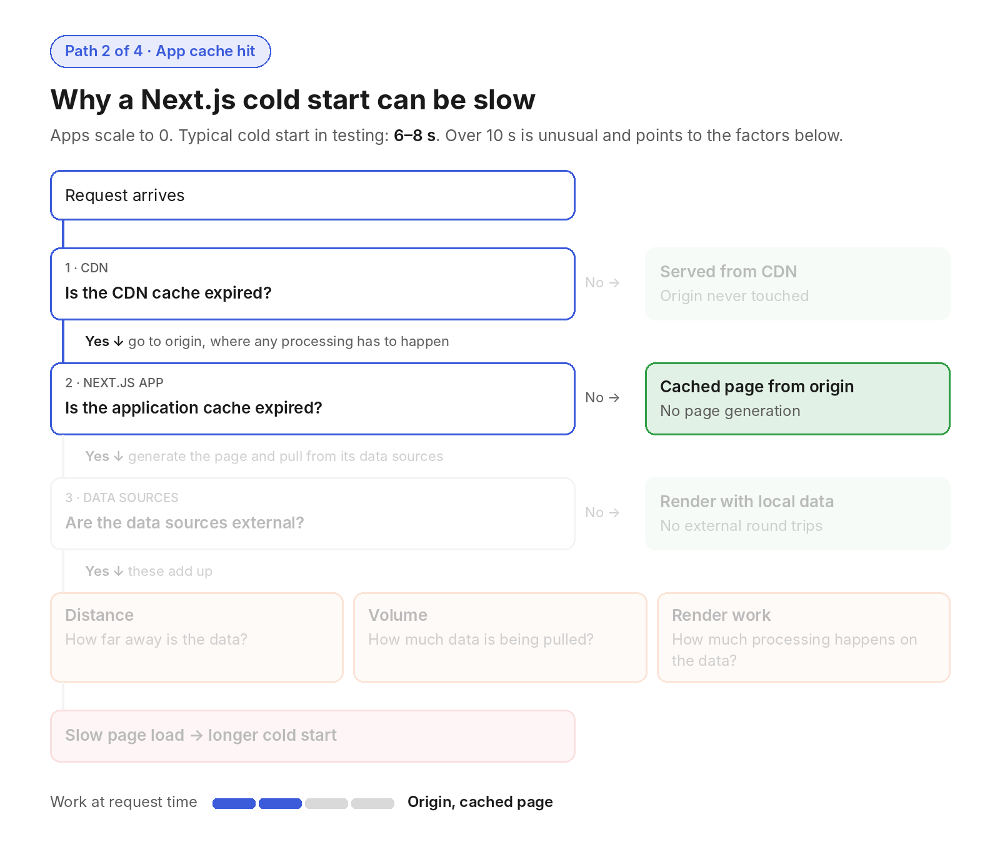
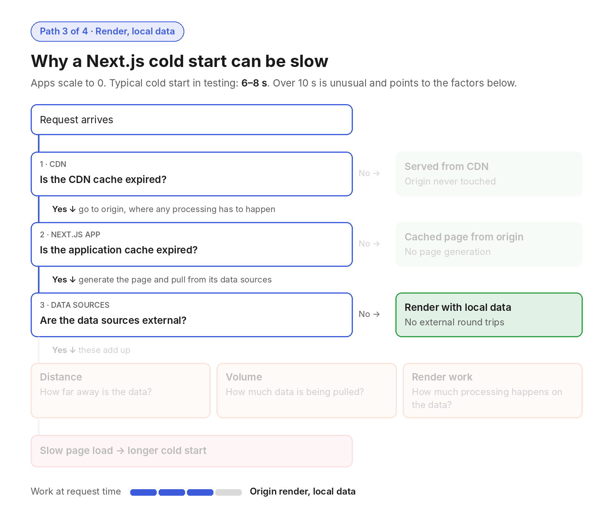
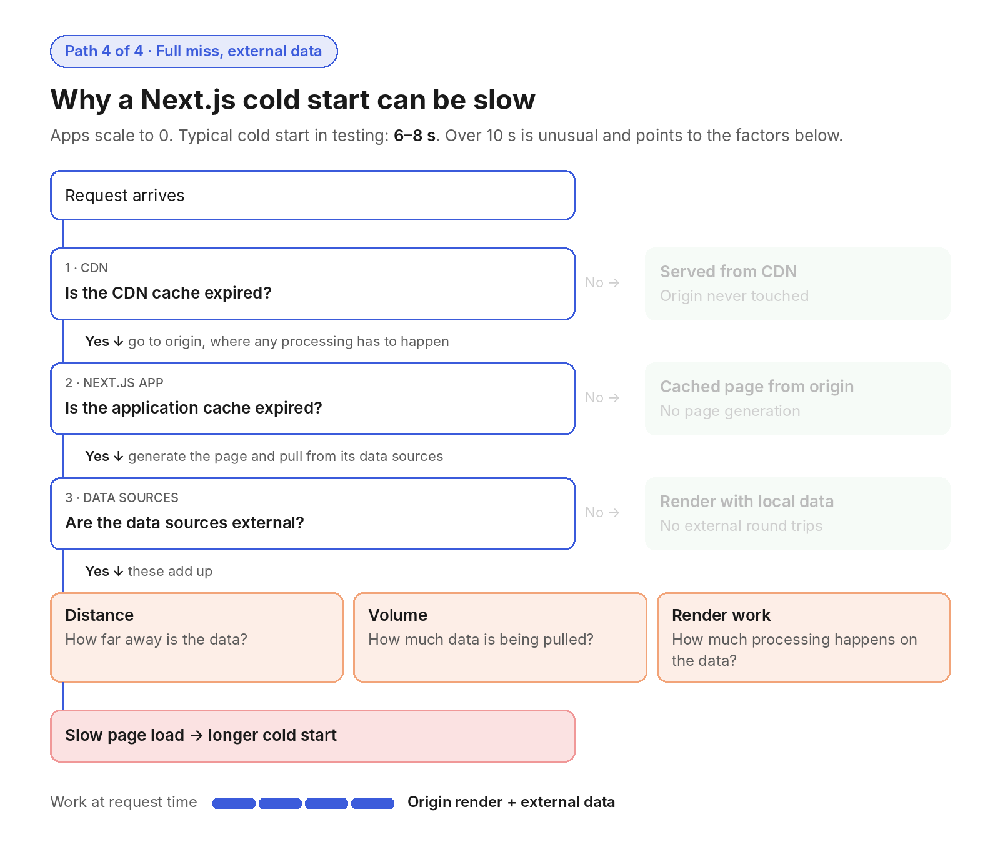

Next.js is the leading React framework for building web applications and sites.
It stands out for its use of cutting edge development techniques and strong commitment to performance for the end users of the web.

## Access & Availability

Support for Next.js is available to customers with Gold, Platinum or Diamond Workspaces because those workspaces have access to [Multidev](/guides/multidev). Multidev environments create a unique site per Git branch which we consider essential for teams to be productive with Next.js on Pantheon.

### Compatibility & Requirements
* **Node versions:**
  * Pantheon provides the latest 3 LTS versions of Node.js. Pantheon derives which one to use by looking at the engines property in `package.json`, so ensure this is set in your project’s configuration.
* **Package managers:**
  * Pantheon will use `npm`, `yarn`, `pnpm`, or `bun` depending on which lock file you have present in your repository. Having a lock file for more than one package manager can create unpredictable behavior.
* **Expected commands in `package.json`:**
  * Pantheon assumes that a Next.js site has a `package.json` file with `build` and `start` commands. If your build produces [standalone output](/nextjs/standalone-output), Pantheon starts the standalone server directly and does not run `start`. Sites using `yarn` must have a `gcp-build` script instead of, or in addition to `build`. We consider inconsistency a bug in underlying Google Cloud build processes we leverage and [will update this guidance once it is resolved](https://github.com/pantheon-systems/documentation/issues/9888).

* **External version control:**
  * Next.js sites require code hosted in a GitHub or GitLab repository. Bitbucket support is planned for a future release.

### Usage
To get up and running with Next.js on Pantheon, we recommend [starting with a simple "Hello World" site following this tutorial](/nextjs/hello-world-tutorial) or a basic integration of [Next.js and Content Publisher](/nextjs/content-publisher-tutorial).

To pair Next.js with a CMS backend, start with the guide for your content source:

* [Drupal + Next.js Quick Start](/nextjs/drupal-quickstart) — a decoupled Drupal 11 backend serving Next.js over JSON:API, with [cache revalidation](/nextjs/drupal-revalidation-tutorial) and [draft preview](/nextjs/drupal-preview-tutorial).
* [WordPress on-demand cache revalidation](/nextjs/wordpress-revalidation-tutorial) — a headless WordPress backend serving Next.js over the WP REST API.
* [Content Publisher](/nextjs/content-publisher-tutorial) — author in Google Docs with no backend to host.

If you have previously launched a Next.js site via [Pantheon's Front-End Sites, use this guide for migration](/nextjs/migrating-from-front-end-sites).

Most of the tasks related to developing a site with Next.js on Pantheon can be done through the Pantheon dashboard.
We also provide [command line equivalents](/nextjs/cli-tools) for many tasks like log viewing and site creation.

## Key Features
Pantheon makes teams using Next.js more effective by:

* Providing a container-based runtime environment that holds all the dependencies needed to run Next.js applications.
* Storing cached responses both in our Global CDN and a persistent layer that is shared across horizontally scaled containers.
* Providing a Git-based workflow that integrates with GitHub to enable Continuous Integration and Continuous Deployment.
* Offering a dashboard and command line tool for managing environments, viewing logs, and scaling resources.

We do all of this on the same platform that powers thousands of Drupal and WordPress sites.
While Next.js is fundamentally a server-side application, it does not dicate where and how data is stored.
By running Next.js on Pantheon, you can combine it with Drupal, WordPress or Content Publisher to provided a unified approach to content management and delivery.

## Considerations

### Cold starts

Next.js applications running on Pantheon can scale down to 0 servers and, when scaling back up, you may see long cold starts. The reason boils down to what happens when the scale-up request comes in:

If the cache is still vald, for instance, the site will be served from CDN, and the cold start will be relatively short:

If the CDN copy has expired, the request goes to origin, and a container must start if the environment has scaled to zero. If the Next.js cache has a fresh copy of the page, the application serves it without generating the page. The Pantheon cache handler stores this cache persistently, so it survives container restarts.

If your app cache is valid, you'll serve from there, making a shorter but not the shortest possible response time. 

If the Next.js cache has also expired, the application has to generate the page and pull from every data source the page needs. When that data is local to the application, there are no external round trips, but the page still has to render.

If the page pulls data from external sources, such as a WordPress, Drupal, or Content Publisher backend or a third-party API, three factors add to the response time:

- Distance: how far away the data source is from your application.
- Volume: how much data the page pulls.
- Render work: how much processing the page does on that data while rendering.

Combined with a cold start, these factors produce the slowest first page loads.

### Reduce the impact of cold starts

- Lengthen cache lifetimes. Use cacheLife profiles to keep pages fresh longer, for example one day before they go stale, and expire them after that. Longer lifetimes let the CDN hold pages longer, so fewer visitors trigger a request to a container that has scaled to zero.
- Use the Pantheon cache handler. It keeps the Next.js cache in persistent storage shared across containers, so a container that just started can serve cached pages instead of regenerating them.
- Reduce per-request data work. Fetch only the data a page needs, cache data fetches where you can, and keep data sources close to your application.

See the following page for more limitations of Next.js functionality on Pantheon:
* [Limitations and considerations for Next.js](/nextjs/considerations)
