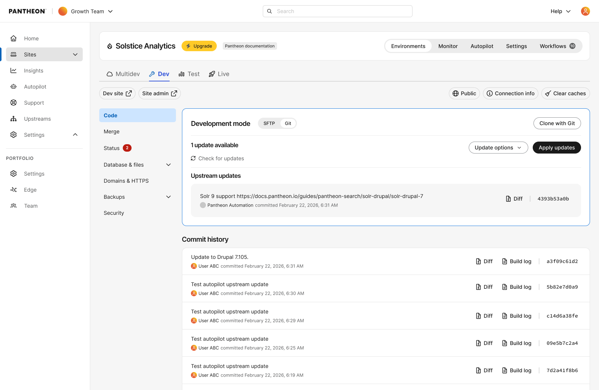
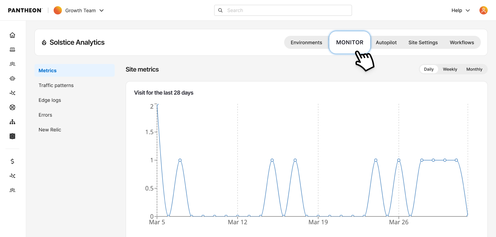
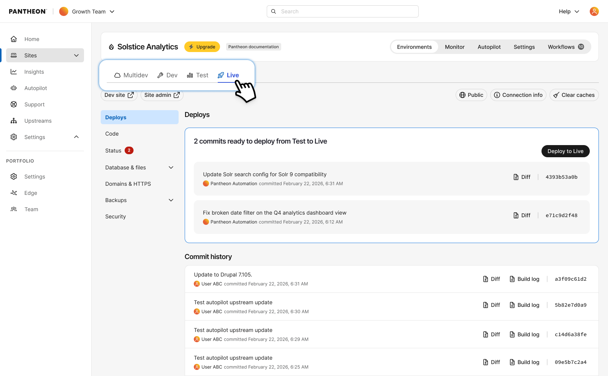
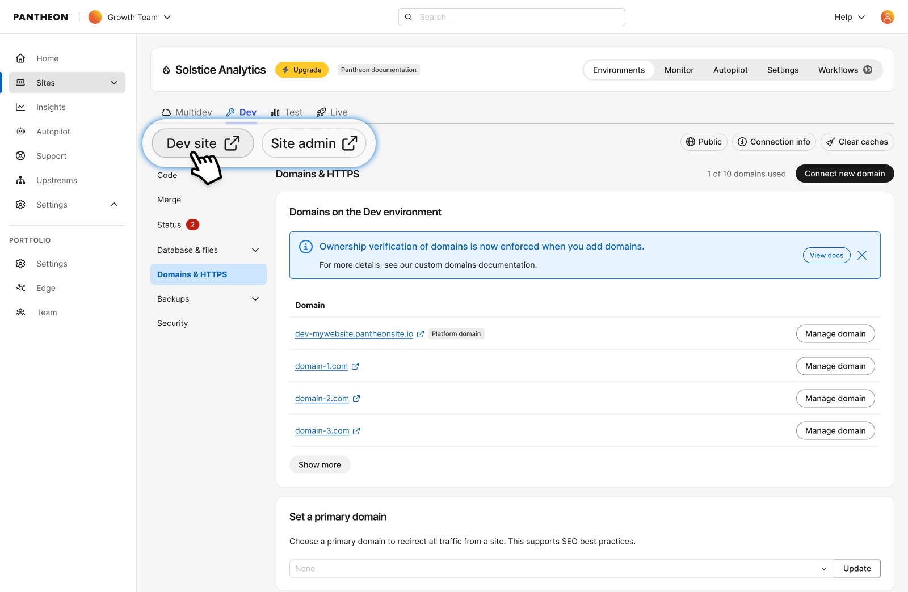

The Pantheon Site Dashboard is the hub of all development and activity for an individual site.

## Header Elements

On the top left of the page, you will see the following information:

- The icon for the CMS you have installed
- The name of the site
- If applicable, a yellow **Upgrade** button, that will allow you to [upgrade the site](/guides/account-mgmt/plans/site-plans)
- If applicable, the name of the Professional Workspace containing this site

## Site-level tabs
The top of the site dashboard contains tabs for the main areas of your site. These are accessible from anywhere within the site dashboard without needing to navigate into a specific environment first.

### Environments

The Environments tab provides access to your site's individual environments: Multidev, Dev, Test, and Live. See [Environment Tabs](#environment-tabs) below for details on each environment.

### Monitor
The Monitor tab is your central hub for observing site health, diagnosing issues, and understanding traffic.

<Alert title="Note" type="info">

This feature requires your site to be on our [next-generation Global CDN](/guides/nextgen-gcdn). If your workspace includes sites still on our legacy Global CDN, your performance overview will only reflect migrated sites.

If you have not started or completed your migration, [visit our documentation](/guides/nextgen-gcdn/setup) to get started.

</Alert>

Monitor contains the following pages:
* **[Metrics](/guides/account-mgmt/traffic)**: View performance data for your Live environment, including response times and cache hit rates.
* **[Traffic Patterns](guides/account-mgmt/traffic)**: Analyze request volume, traffic trends, and visitor behavior across your site. Traffic Patterns is now a dedicated page, previously found at the bottom of the Metrics page.
* **[Edge Logs](/guides/account-mgmt/edge-logs)**: Log explorer for all HTTP traffic.
* **Errors**: Access links to your error logs and find out how to diagnose issues on Pantheon via SFTP.
* **[New Relic](/guides/new-relic)**: Use this application performance monitoring tool to identify bottlenecks and optimize your site. Only visible if your site has New Relic enabled on its plan.

### Autopilot
Autopilot automatically detects, performs, and deploys updates for WordPress and Drupal. Learn more about [Autopilot](/guides/autopilot).

### Site Settings
Manage site-wide configuration including site details, team access, billing, add-ons, email service, and secrets.

### Workflows
View the full audit trail of actions taken on your site using [Workflow Logs](/workflow-logs), including deploys, cache clears, and automated updates. You can filter by environment or workflow status.

## Environment Tabs
Within the Environments tab, you can switch between your site's environments using the environment selector.

### Multidev

Multidev enables developers to design and build in multiple concurrent development environments with just a few clicks without touching the live site.

### Dev

By default, you’ll find yourself on this tab. This is your development environment. It provides access to a stand-alone copy of your site, with its own codebase, database, and files.

Within the safety of this isolated environment, you can edit code and make updates to your site. All development on your Pantheon sites starts here.

### Test

This environment is for reviewing the changes made in your Dev environment with the most recent content from your live site.

### Live

This environment is for your live site, where content creators actively post and upload media files. After passing review, you push your new code “up” from the Test environment to this Live environment.

## Inner left-hand navigation
When inside an environment (Dev, Test, Live, or Multidev), you'll see a left-hand navigation menu with environment-specific tools.

The following buttons appear above the left-hand navigation menu on every environment:

- **`Environment` site**: Opens the homepage of your site for the current environment in a new tab. For example, Test site or Dev site.

- **`Environment` admin**: Opens your site's admin login page for the current environment in a new tab. If you're not logged in, this opens `/user/login` for Drupal and `/wp-login.php` for WordPress. Once logged in, it takes you to `/user` for Drupal and `/wp-admin` for WordPress.

<Alert title="Note" type="info">

By default, these buttons open links served via their respective [platform domains](/guides/domains/platform-domains) (e.g., `test-example.pantheonsite.io`). To use a custom domain instead (e.g., `test.example.com`), connect a [custom domain](/guides/domains/custom-domains) and configure it as the [primary domain](/guides/domains/primary-domain) for that environment. 

</Alert>

The following navigation items are available within each environment:

- **Code:** Switch between SFTP Connection Mode and Git Connection Mode. Obtain SFTP Connection Info, and commit changes to your Dev environment. The center of this page shows the site's commit log with an activity feed of all code changes. _(Only accessible in Dev or Multidev environments.)_

- **Deploys:** View a deploy log for the environment. _(Only accessible in Test and Live environments.)_

- **Merge:** If you have a Multidev environment, use this tab to merge branches into your master branch. _(Only accessible in the Dev environment.)_

- **Status:** Check this page regularly — especially before going live for the first time — to catch common problems and follow best-practice recommendations for site configuration.

- **Database / Files:** Workflow tools for cloning your database and files between environments.

  - **Clone:** Clone the database and/or files from one environment to another.

  - **Import:** Replace your current database and files with an archive.

  - **Export:** Package and download your database and files in an archive.

  - **Wipe:** Reset the database and files, and start fresh with your codebase.

- **Domains/HTTPS:** Add custom domains to your site, enable SSL, and manage certificates.

- **Backup:** Create a backup of the environment.

  - **Backup Log:** View existing backups. Click the Download icon to download individual archives.
  - **Backup Schedule:** Schedule daily or weekly automatic backups. _(Only available on paid plans.)_

- **Security:** Set a password for accessing this environment.

- These navigation items are only available on sites not yet migrated to the next-generation Global CDN. On migrated sites, New Relic is found under the Monitor tab.
  - **Errors:** Access links to your error logs and find out how to diagnose issues on Pantheon via SFTP.
  - **New Relic:** Use this server-side performance monitoring tool to identify bottlenecks and optimize your site.
  - **Metrics:** View traffic and caching data for your Live environment.