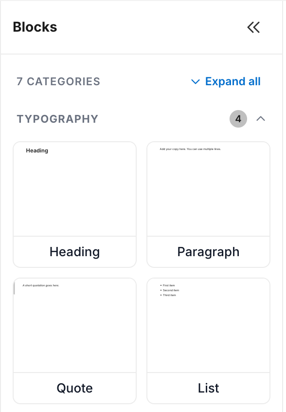

**Component sidebar:** A new visual sidebar shows live preview cards so you can see components before adding them.

**Outline panel:** Replaces the old layer list with collapsible field sections, inline help text, and a restyled collaborators indicator.
