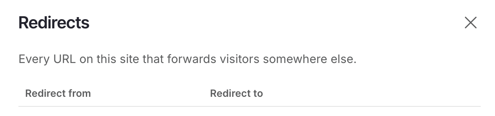

This release brings a set of improvements to the P1 dashboard and editing experience — new tools for managing redirects and archiving sites, a simpler setup flow, and a refreshed, more consistent interface.

## New features and improvements

**Manage page redirects from the dashboard:** You can now create and manage page redirects directly in the dashboard, so you can keep links working when content moves — without leaving P1.

**Archive and restore sites:** Archive sites you're no longer actively working on to keep your workspace focused, and restore them at any time. Your content, settings, and tokens are preserved.

**Simpler site setup:** The Pantheon site ID is now optional when creating a site in the P1 dashboard, so you can get started faster and connect a Pantheon site later.

**Additional page management:** The site structure page allows you to move pages to nest within a section or page. We’ve also added a new view of a page's JSON, available by selecting a page from the site structure listing.

**A refreshed, more consistent dashboard:** We've updated the dashboard to the latest Pantheon Design System — cleaner tables, cards, empty states, links, and dialogs across the app — and restored the classic P1 logo.

## Fixes and refinements

* **"Open editor" links now resolve correctly**, fixing a case where an extra slash could break the link.
* **Your default space is selected automatically again** when you open the dashboard.
* **More accurate Sync tab**, so changes between environments are reflected reliably.
* **Improved account picker** when connecting a document.
* **Spacing and contrast polish** across settings tables and dialogs.
